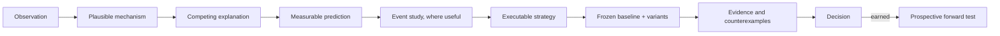

# Research roadmap

*Direction and priorities. Update only when the direction changes. Current state lives in
[`../lab/HANDOFF.md`](../lab/HANDOFF.md); hypotheses and results live in
[`STRATEGY_RESEARCH_LEDGER.md`](STRATEGY_RESEARCH_LEDGER.md) and the study folders. Adopted 2026-10-16.*

## Purpose

A reusable Python research and learning lab. It turns observations and external ideas (videos, charts,
papers) into explicit hypotheses. It runs a baseline plus a few named variants in one batch, and produces
interactive HTML that is easy to understand. It replaces the manual TradingView toggle, export and upload
cycle.

## Technical direction

- **Backtesting.py first.** Consider NautilusTrader only after showing that a required capability cannot
  be handled cleanly, with a failing test.
- **Demonstrated scope:** single-instrument, bar-based strategies, compared independently on the same data,
  capital and costs. **Outside the demonstrated scope:** options, multiple strategies sharing capital,
  quote-level execution.
- Reuse existing libraries. Keep custom execution and reporting code narrow. A new strategy should need only
  its own module and config (proved twice: VWR in October, and the VMR-L mean-reversion family).
- Review at meaningful seams; otherwise keep moving.
- Challenge hypotheses. **A negative result is evidence, not a prompt to search for rescue variants.**

## The VWAP research group (hypotheses, not established edges)

| Family | Idea | Status |
|---|---|---|
| **Continuation** | Established directional acceptance relative to VWAP, an orderly pullback, then continuation | August VDC/FPC: no edge. October VWR (a *same-bar touch/reclaim proxy* with **no** prior-trend requirement; not a continuation test as defined here): negative |
| **Mean reversion** | Displacement from VWAP, then failed extension, then movement back toward VWAP | VMR-L proposed (`studies/vwap-mr-2026-10`); August VMR design parked |
| **Reversal** | Established acceptance fails, followed by sustained movement across VWAP | Not yet designed |

VWAP's role as an institutional execution benchmark does **not** by itself establish a directional signal,
and it does not prove institutional intent. Keep these apart:

| Concept | What it measures |
|---|---|
| Distance from VWAP | How far price is from the day's volume-weighted average (e.g. in ATR units) |
| EMA separation / expansion | How far fast and slow EMAs have fanned apart |
| Persistence of expansion | How long that separation has lasted |
| Shock fan-out vs sustained structure | A brief, news-driven spike versus a directional move that keeps building |

## Research process

- Start with few variables and one-factor changes. **Keep entry/context experiments separate from exit
  experiments.**
- Group ideas by **mechanism**. A new video or indicator combination joins an existing family when it makes
  the same claim.
- Collect failures and ordinary cases, not only attractive examples.
- Preserve every tested configuration and every negative finding (the ledgers and frozen manifests).

### Research card (one per family; it lives in the ledger, with full detail in the study manifest)

| Field | |
|---|---|
| Family, source, date | |
| Directly stated rules vs lab assumptions | |
| Observation · mechanism · competing explanation | |
| Measurable hypothesis · primary comparison | |
| Baseline · small declared variant batch | |
| Data · execution · costs · sizing | |
| Status · linked results · conclusion · next question | |

## Learning: terms used in this lab

| Term | Plain meaning | What it can show |
|---|---|---|
| **Backtest** | Run explicit rules over historical data | What the rules *would have done*, under the stated execution assumptions |
| **Historical validation** | Assess *frozen* rules on history held back from design, stating any prior exposure | Whether a result holds on data the design did not use. It is weaker when that data was looked at before |
| **Forward test** | Freeze the rules now, then record genuinely new observations as they arrive | Performance on data that did not exist when the rules were fixed. This is the only real holdout (conventions §g) |
| **Paper trading** | Simulated orders against live prices | It can support a forward test. It does **not** prove fills were executable |
| **Fresh historical data** | Data acquired after a study but dated before today (e.g. 2026-08-24 → 2026-10-15) | New evidence on unchanged rules. It is **not** a forward test, because it existed when the rules were frozen |

**Windows.** Reports show full history, calendar halves and the latest six months, each with exact dates,
warm-up and capital-reset conventions. Recent windows overlap the full history and are exploratory. The
view that markets behave differently now remains a **hypothesis**. There is no fitted regime classifier
for now.

## Reporting direction (accepted 2026-10-16)

Summary → Compare → Inspect trades → collapsed Technical details. Lead with findings, dates and material
limitations. Default to baseline plus benchmark, and one-variant comparisons. Keep portfolio metrics
separate from trade R. Offline HTML, readable on Android, with computation provenance recorded.

## Priorities (in order)

1. VMR-L strategy-definition review, then its frozen single run.
2. Decide the data treatment for the suspicious prints (`../lab/DATA_QUALITY_2026-10-16.md`) before the
   next comparison that is sensitive to stops.
3. Reversal family design, once mean reversion has a result.
4. Prospective forward testing, only for a configuration that earns it.

## Continuity

The repository is the source of truth; chat context and private artifact links are conveniences. When an
experiment finishes, update its card in the ledger and [`../lab/HANDOFF.md`](../lab/HANDOFF.md). Change
this roadmap only when the direction changes.
